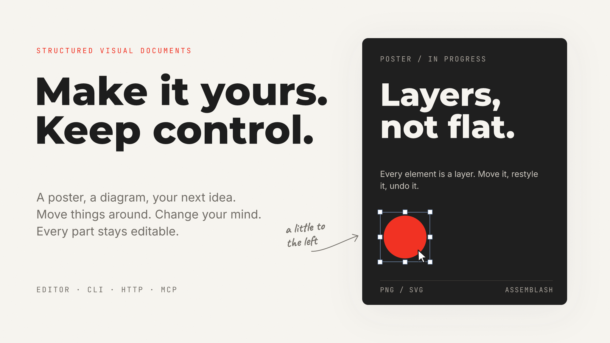
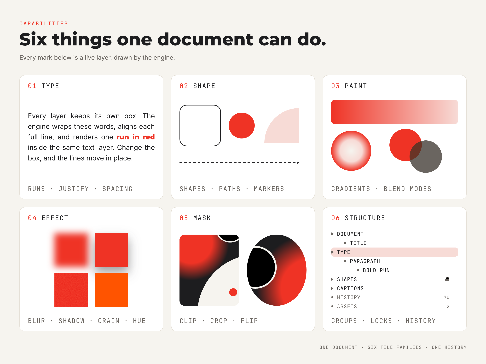
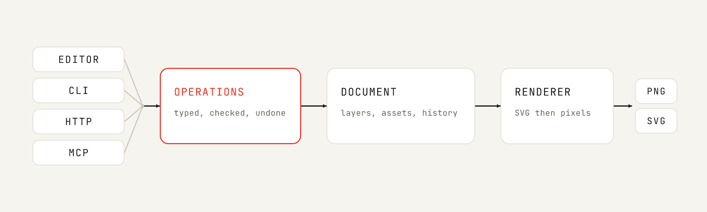

<p align="center">
  
</p>

<h1 align="center">Assemblash</h1>

<p align="center">
  A structured visual document engine for people, scripts, and AI agents.
</p>

<p align="center">
  <a href="https://github.com/VidGuiCode/assemblash/releases/latest"></a>
  <a href="https://github.com/VidGuiCode/assemblash/actions/workflows/ci.yml"></a>
  <a href="LICENSE"></a>
  
</p>

<p align="center">
  
</p>

<p align="center"><sub>A real document, drawn by the engine. <a href="examples/readme-hero">Open the editable project.</a></sub></p>

## What Assemblash is

Assemblash makes visual documents: posters, social images, diagrams, and
templates. You build a document from text, shapes, images, and SVG files. The
document stays editable. Every layer stays a layer, every change is recorded,
and the export has the same content as the editor.

One program contains four interfaces:

- the reference editor for people;
- a command line for scripts;
- a local HTTP API for applications;
- an MCP server for AI agents.

A person and an agent can change the same open document at the same time. There
is no cloud service and no account. Assemblash contains no AI model; the agent
brings its own.

The reference editor is available in English, French, and German. To set its
appearance, open **Settings** → **Application** and select Light, Dark, or
System. The browser stores this choice locally. It does not change document
colours.

**Current release: 1.13.0.** The document schema and the operation API are
stable since 1.0. See the [release notes](https://github.com/VidGuiCode/assemblash/releases/tag/v1.13.0)
or the [changelog](CHANGELOG.md).

## What one document can hold

<p align="center">
  
</p>

<p align="center"><sub>Six capability tiles, all in one editable project. <a href="examples/readme-capabilities">Inspect it.</a></sub></p>

- **Layers.** Text, raster image, SVG, rectangle, ellipse, line, path, and
  nested groups.
- **Text.** Styled runs, justified alignment, paragraph spacing, vertical
  alignment, and exact font files.
- **Paint.** Solid colours, linear and radial gradients, fourteen blend modes,
  and a non-destructive effect stack.
- **Geometry.** Rounded corners, dashes, arrow and circle markers, clip, crop,
  flip, rotation, and opacity.
- **Templates.** Named slots, presets, and deterministic variant batches.
- **Record.** Undo, redo, history, version checks, dry runs, and protected
  layers.

## Quick start

You do not need a terminal for these steps.

### 1. Download Assemblash

Go to [GitHub Releases](https://github.com/VidGuiCode/assemblash/releases/latest)
and download the file for your computer. The file is the complete program. You
do not install anything else.

| Your computer | Download this file |
| --- | --- |
| Windows | `assemblash-<version>-windows-x86_64.exe` (on an ARM laptop: `windows-aarch64`) |
| Mac with Apple silicon (M1 or newer) | `assemblash-<version>-macos-aarch64.tar.gz` |
| Mac with an Intel processor | `assemblash-<version>-macos-x86_64.tar.gz` |
| Debian or Ubuntu | `assemblash_<version>_amd64.deb` (on ARM: `arm64`) |

For example, the Windows file of release 1.13.0 is
`assemblash-v1.13.0-windows-x86_64.exe`.

### 2. Start Assemblash

- **Windows:** double-click the `.exe` file. If Windows shows "Windows
  protected your PC", click **More info**, then **Run anyway**.
- **Debian or Ubuntu:** install the file with
  `sudo apt install ./assemblash_<version>_amd64.deb`. Then open Assemblash
  from the application menu.
- **Mac:** double-click the `.tar.gz` file to unpack it. Then double-click
  `assemblash`. The first time, macOS blocks it, because the program is not
  signed with an Apple Developer ID. Do these steps once:
  1. In the warning, click **Done**.
  2. Open **System Settings** → **Privacy & Security**.
  3. Find the message about `assemblash` and click **Open Anyway**.
  4. Double-click `assemblash` again and confirm.

  As an alternative, remove the quarantine flag in a terminal:
  `xattr -d com.apple.quarantine ./assemblash`. A Homebrew tap would remove
  this step, but the tap is not published yet. The formula is in
  `packaging/homebrew/`.

The editor opens in your web browser. A small text window also opens (a
console window on Windows, a Terminal window on a Mac). Keep that window open
while you use Assemblash. If you start Assemblash a second time, it opens the
editor that already runs.

### 3. Make your first document

1. Click **Create a project**. Type a name, select a size, and click
   **Create project**.
2. Add content with the tools on the left: **Text**, **Shapes**, **Uploads**
   (images), and **Vector** (SVG files).
3. The first time, open **Fonts** and install the default pack (Noto Sans,
   Noto Serif, and Noto Sans Mono). This is the only step in this guide that
   downloads something.
4. Click a layer on the canvas to select it. Drag it to move it. Change its
   properties in the panel. Use **Undo** and **Redo** at the top.
5. Click **Export** and select PNG or SVG.

Assemblash saves every change immediately. There is no **Save** button.

### 4. Let an AI agent work with you

An AI agent, for example Codex or Claude, can work on your projects while the
editor is open. You see the agent's changes as they happen.

1. Start Assemblash.
2. In the editor, click the robot button at the top: **Connect an AI agent**.
   This window also opens by itself the first time you start Assemblash.
3. Click **Copy** on the configuration for your AI client.
4. Paste it into the MCP settings of your AI client, then restart the client.
   For Codex, add it to `~/.codex/config.toml`, or use **Settings** →
   **MCP servers** → **Add server** → **STDIO**. For other clients, use the
   first block when the client starts a command, or the URL when the client
   asks for a URL.
5. Ask the agent, for example: "List my Assemblash projects."

The copied configuration contains the full path of the program and of your
workspace. Do not replace the path with only `assemblash`. A downloaded program
is not on your `PATH`, so the client cannot find it by name.

Keep the editor open while the agent works. If the agent starts before the
editor, it works alone. When you start the editor, the agent moves to it
automatically.

### 5. Stop Assemblash

Click the power button at the top right of the editor: **Stop Assemblash**.
Your work is already saved. If you started Assemblash from a terminal, you can
also press Ctrl+C there.

### Where your projects are

Assemblash keeps your projects, fonts, and settings in one folder, the
**workspace**:

| System | Workspace folder |
| --- | --- |
| Windows | `%APPDATA%\Assemblash` |
| Mac | `~/Library/Application Support/Assemblash` |
| Linux | `~/.local/share/assemblash` |

Each project is a folder in `projects/`. You can copy a project folder to back
it up or to give it to another person.

### If something does not work

| Problem | What to do |
| --- | --- |
| macOS says the program "cannot be opened" | Do the **Open Anyway** steps in step 2. |
| The browser does not open | Open `http://127.0.0.1:8787` in your browser. The small text window shows the address when it is different. |
| The AI client cannot start Assemblash | Use the configuration from **Connect an AI agent**. It contains the full path of the program. |
| The agent reports `projectLocked` | Another Assemblash process has the project open. Connect the agent to the running editor (step 4). Never delete a `.assemblash-lock` file. |
| The agent reports `versionConflict` | This is normal when you and the agent edit the same project. The agent reads the document again and retries. |
| An error says that a font is missing | Install the font in **Fonts** (step 3). Assemblash never uses a different font without telling you. |

## Four ways in

<p align="center">
  
</p>

<p align="center"><sub>Every interface becomes the same validated operation. <a href="examples/readme-pipeline">Inspect the diagram.</a></sub></p>

| Interface | Best for | Start with |
| --- | --- | --- |
| Reference editor | Creating and refining documents visually | Launch `assemblash` |
| CLI | Shell scripts and straightforward local workflows | `assemblash --help` |
| HTTP API | Applications and custom frontends | `assemblash serve` |
| MCP server | AI agents and MCP-compatible clients | **Connect an AI agent** in the editor, or `assemblash mcp` |

The editor is a reference client. It has no special access. Edits in the
editor, CLI commands, HTTP requests, and MCP tools all become the same
operations. The API and the MCP server contain no document logic of their own:

- `assemblash-core` does the validation and the operations.
- `assemblash-renderer` does the rendering.
- The server, MCP, and CLI crates give these functions to different clients.

Rust programs can use the same crates directly. They are in [`crates/`](crates/).

### Create and export from the CLI

Assemblash never substitutes a system font without telling you. Install a font
into a font store once, then use the same font store when you export:

```sh
assemblash font install "Noto Sans" --font-store ./assemblash-fonts
assemblash new ./poster --width 800 --height 400 --background '#f6f4ef'
assemblash add-text ./poster --text "Hello" --font "Noto Sans" --size 64 --x 40 --y 40 --width 720 --height 120
assemblash add-rect ./poster --x 40 --y 200 --width 240 --height 96 --fill '#1d1d1f' --corner-radius 12
assemblash export ./poster --out poster.png --font-store ./assemblash-fonts
```

`render` and `export` print the written path and its `sha256:` digest as one
tab-separated line. A script can compare what two interfaces produced without
hashing the file itself.

One command is one operation, however many flags it has. The history records
it once, and one undo reverts it. Run `assemblash --help` or
`assemblash <command> --help` for the complete command reference.

### Install from source

Builds need [Rust 1.92 or newer](https://www.rust-lang.org/tools/install):

```sh
cargo install --git https://github.com/VidGuiCode/assemblash --tag v1.13.0 assemblash-cli
```

## Why Assemblash

Usually you must choose. An editor with many controls is difficult to automate.
A code or image-generation pipeline gives a flat image, and a flat image is
difficult to change. Assemblash gives you structure and automation together.

- **Structured, not flattened.** Documents keep their layers, groups, assets,
  metadata, templates, and named slots.
- **Local by default.** Create, edit, render, and export work offline. No
  account or AI provider is necessary.
- **Safe to automate.** Mutations are typed, validated, journalled, versioned,
  dry-runnable, and undoable. Protected content stays protected.
- **Deterministic.** The same document, assets, and pinned font files give
  bit-identical PNGs. This holds on all six release targets.
- **Embeddable.** Use the Rust crates, HTTP API, CLI, or MCP server. You do not
  need to drive the reference editor with clicks.

Assemblash does not replace Photoshop, GIMP, or Figma. It is a composition
engine for repeatable visual assets, templates, and work with AI agents.

## History and safety

Every change uses the same transactional operation layer. A refused operation
does not change the document. The history records each successful operation
with its actor and transaction ID. You can undo and redo it, also after a
restart.

- Expected-version checks prevent stale clients from overwriting newer work.
- A dry run shows what a mutation would do without committing it.
- `locked`, `protected`, and `readOnly` layers are enforced in the engine.
- Project and asset paths stay inside the configured filesystem boundary.
- Assemblash sanitises an imported SVG before it enters the asset store.
- A change from an agent goes through the same validated operations as a
  click. The history records the agent as the actor, so you can review it and
  undo it.

## Platform compatibility

The same six platforms are built, tested, and included in every release:

| Operating system | x86_64 / Intel / AMD64 | ARM64 / AArch64 |
| --- | :---: | :---: |
| Windows | ✅ `.exe`, `.zip` | ✅ `.exe`, `.zip` |
| Linux | ✅ `.deb`, `.tar.gz` | ✅ `.deb`, `.tar.gz` |
| macOS | ✅ Intel `.tar.gz` | ✅ Apple silicon `.tar.gz` |

Every release also contains one `.exe` for each Windows target and one `.deb`
for each Linux target. macOS has no installer yet. See the **Open Anyway**
steps in the Quick start.

The release workflow checks that every binary starts before it attaches the
binary. CI also runs the Rust workspace tests on all six targets. The reference
editor runs in a modern browser and is served by the executable itself.

## Stability and current limits

Assemblash 1.x makes two compatibility promises:

1. A document written by 1.0 remains readable by every 1.x release.
2. A client written against the 1.0 operation API keeps working across 1.x.

A change that breaks one of these promises needs a major release and a
documented migration. New fields have default values. Unknown document fields
stay in the document when it is loaded and saved.

The important limits:

- Assemblash contains no AI image generator or AI provider adapter.
- Fourteen blend modes are supported. `color-dodge` and `color-burn` are
  refused because they are not bit-identical across every target.
- The stroke of a shape is painted inside its box, so the box is the visible
  size. A stroke narrower than 1 is a hairline on the edge.
- A path shape paints its fill. In 1.13.0 it does not paint its stroke.
- Built-in authentication is one shared token. Accounts, roles, OIDC, SSO,
  TLS, and per-user audit identity belong in a reverse proxy.
- The editor is a reference client. It is not a complete professional design
  application.

## Learn more

| Document | What it covers |
| --- | --- |
| [docs/document-model.md](docs/document-model.md) | Layers, groups, canvas, clipping, paths, and persistence |
| [docs/text-and-fonts.md](docs/text-and-fonts.md) | Font store, styled runs, justification, and warnings |
| [docs/paint-and-rendering.md](docs/paint-and-rendering.md) | Gradients, blend modes, effects, and the renderer |
| [docs/automation.md](docs/automation.md) | CLI, HTTP, MCP, history, locks, and self-hosting |
| [PRD.md](PRD.md) | Scope, requirements, invariants, and product decisions |
| [DEPLOYMENT.md](DEPLOYMENT.md) | Tokens, Docker, TLS, and reverse proxies |
| [CHANGELOG.md](CHANGELOG.md) | Release-by-release history |
| [CONTRIBUTING.md](CONTRIBUTING.md) | Contribution and review expectations |
| [SECURITY.md](SECURITY.md) | Supported releases and private reporting |
| [DEPENDENCIES.md](DEPENDENCIES.md) | Dependency and license inventory |

## Develop and contribute

Clone the repository and run the Rust checks from its root:

```sh
cargo fmt --all --check
cargo clippy --workspace --all-targets --all-features -- -D warnings
cargo test --workspace
```

The TypeScript project is in `ui/`. There is no `package.json` at the root:

```sh
cd ui
npm ci
npm run check
```

`ui/dist/` is committed because the Rust binary embeds it. After you change the
interface, `npm run build` must leave that directory up to date. Then run these
commands from the repository root:

```sh
python scripts/ui_assets.py
python scripts/ui_notices.py
python scripts/ui_assets.py --check
python scripts/ui_notices.py --check
```

Before you propose a change, read [CONTRIBUTING.md](CONTRIBUTING.md). It
explains the stability rules, testing expectations, and the line between the
generic engine and downstream adapters. Report security problems privately as
described in [SECURITY.md](SECURITY.md), never as public issues.

## Try it and tell us what you find

Assemblash is released, and its core contracts are stable. If you use it, tell
us what you made, what worked well, and what caused problems.

- Share a workflow, result, or question in
  [GitHub Discussions](https://github.com/VidGuiCode/assemblash/discussions).
- Report reproducible problems with the
  [bug form](https://github.com/VidGuiCode/assemblash/issues/new?template=bug_report.yml).
- Propose a focused addition with the
  [feature form](https://github.com/VidGuiCode/assemblash/issues/new?template=feature_request.yml).

Do not report security problems in public. Report them privately, as
[SECURITY.md](SECURITY.md) describes.

Assemblash is licensed under the [Apache License 2.0](LICENSE). The public
repository contains only the generic engine and neutral examples. Private
brand kits, credentials, customer assets, and downstream workflows belong
outside it.
